<div align="center">

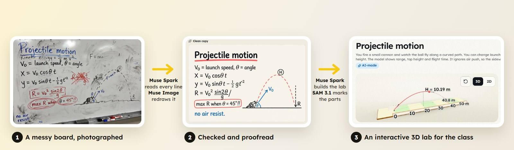

# ConceptLab AI

**Snap a messy whiteboard, a textbook page or a practice video. Get an interactive, source-cited lab your class can open with a code.**

Built on Meta's models: **Muse Spark · Muse Wonder · SAM 3.1 · Muse Image · Muse Voice Transcribe**


<br>


[▶ Watch the demo](#-the-demo-in-3-minutes) · [What it does](#what-it-does) · [How Meta's models power it](#how-metas-models-power-it) · [Run it locally](#run-it-locally)

</div>

---

## ▶ The demo in 3 minutes

<a href="docs/media/conceptlab-demo-720p.mp4">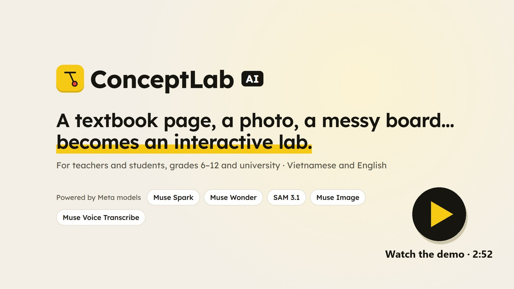</a>

**[Download or play the demo video (MP4, 2:52, English narration)](docs/media/conceptlab-demo-720p.mp4)** · [English subtitles (.srt)](docs/media/conceptlab-demo.en.srt)

What you see, recorded in the real app:

1. **Teacher:** a phone photo of a messy physics whiteboard becomes a lesson. Muse Spark reads it, leaving out the crossed-out formula. The teacher checks the result, and Muse Spark builds a 3D projectile simulation, a graph, a clickable diagram and a quiz. Muse Image redraws the board as a clean, proofread sheet. One click shares the lesson with a class code.
2. **Student:** the pendulum lesson cites its textbook line by line. The bob in the 3D simulation was cut out of a photo with SAM 3.1. The quiz is marked on the server. A spoken question goes through Muse Voice Transcribe and gets a cited answer from the AI tutor.
3. **More:** 3D models for biology, geography, chemistry and engineering, practice videos with SAM-tracked objects, research papers, and Lite mode for low-end phones.

Every AI step in the video is a real Meta Model API call. Waits are fast-forwarded, and the badge on screen shows the real duration (for example *"1 min 01 s in real time, shown 13× faster"*). The whiteboard photo is a sample made with Muse Image for the demo.

## Why

In a typical classroom, the best explanation of the day is often on a whiteboard that gets erased at the bell, or in a static textbook figure. Teachers rarely have time to turn either into a simulation, and many students learn on cheap phones with slow connections. ConceptLab turns what a teacher already has into something students can **try, ask about and check against the source** in minutes, without the AI writing unchecked content for the class.

## What it does

<table>
<tr>
<td width="50%">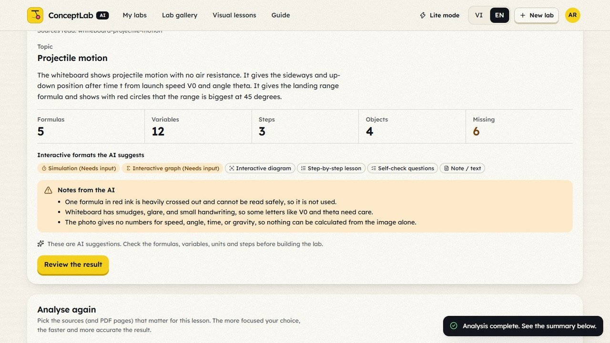</td>
<td><b>Reads what the teacher has.</b> Textbook pages, PDFs, photos of real objects, practice videos and measured values. <b>Muse Spark</b> extracts the topic, formulas, variables, steps and relationships, and says what it left out and why: <i>"a crossed-out formula is unreadable and was not used"</i>, <i>"the photo gives no numbers for speed or angle"</i>.</td>
</tr>
<tr>
<td>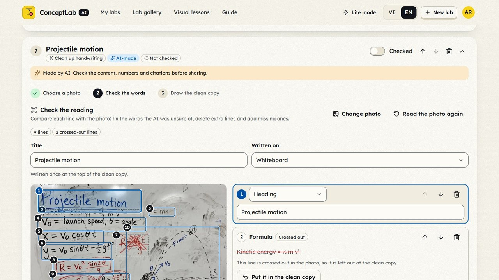</td>
<td><b>Cleans up handwriting.</b> Muse Spark transcribes a board or notebook photo line by line and frames each line on the photo, marking unsure words and crossed-out lines. <b>Muse Image</b> redraws the checked lines as a clean sheet, and Muse Spark proofreads it word by word. If a word differs, the sheet is redrawn.</td>
</tr>
<tr>
<td>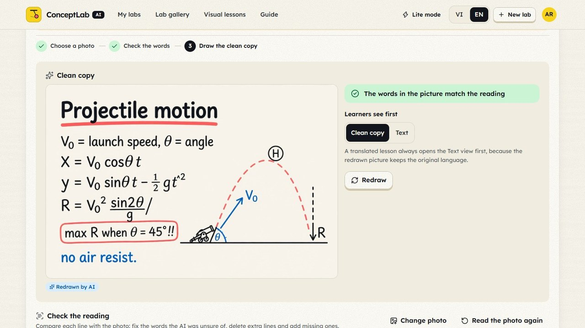</td>
<td><b>Teacher stays in control.</b> Every AI suggestion is labelled <i>AI-made</i> until checked. Formulas and variables are reviewed in plain fields, and questions reach students only after approval. 23 automatic checks run before sharing.</td>
</tr>
<tr>
<td>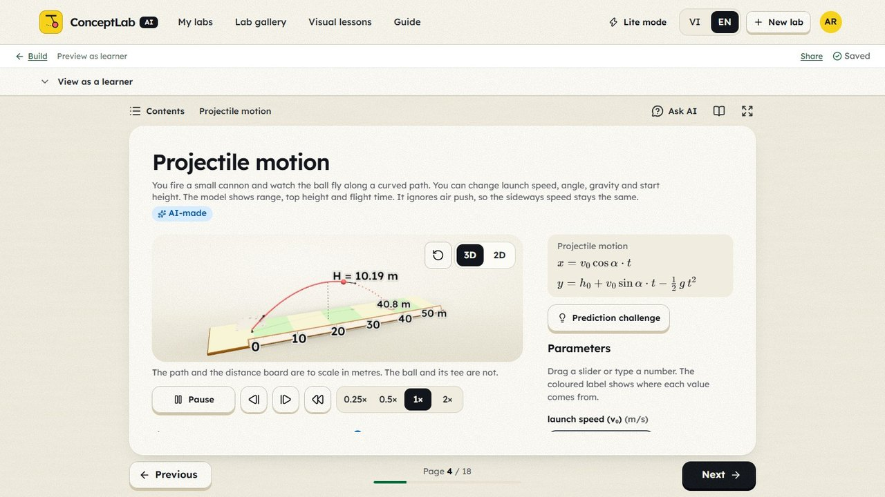</td>
<td><b>Builds interactive parts.</b> 3D and 2D simulations (pendulum, projectile, spring, compound interest) with sliders tied to the real formula, live graphs, clickable diagrams with <b>SAM 3.1</b> hotspots, step-by-step lessons that highlight the exact source line, ordering tasks and quizzes.</td>
</tr>
<tr>
<td>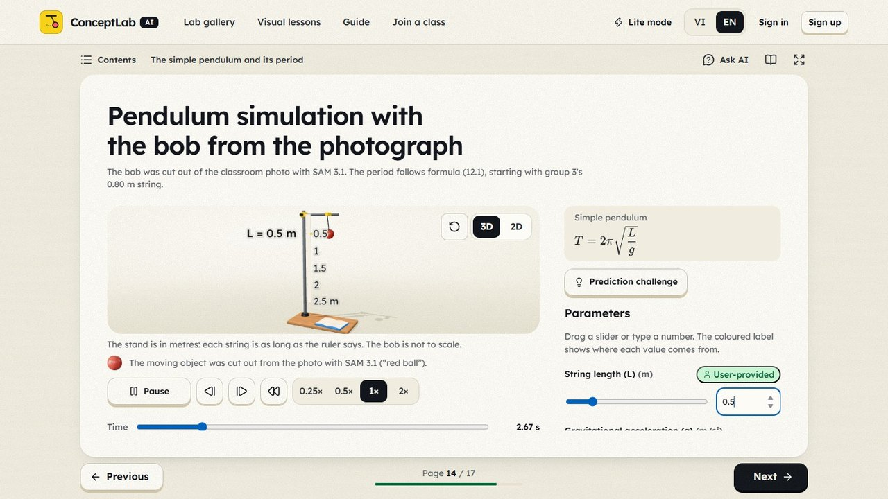</td>
<td><b>Real objects in the model.</b> The pendulum bob in this simulation was cut out of a classroom photo with SAM 3.1. Students change the string length and watch the period change, with the textbook formula beside the model.</td>
</tr>
<tr>
<td>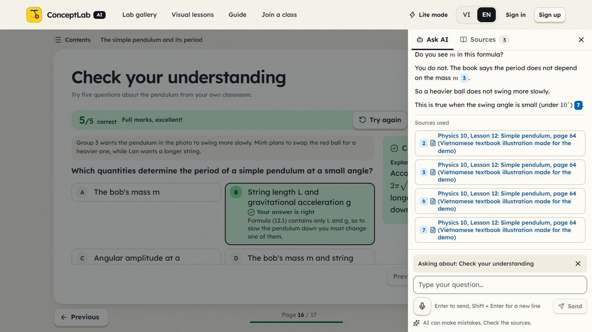</td>
<td><b>An AI tutor that cites.</b> Students type or <b>speak</b> a question (Muse Voice Transcribe). The tutor answers only from the lesson's sources, gives hints before answers, and links each claim to the page or photo it came from. Quiz answer keys never reach the browser: answers are marked on the server.</td>
</tr>
<tr>
<td>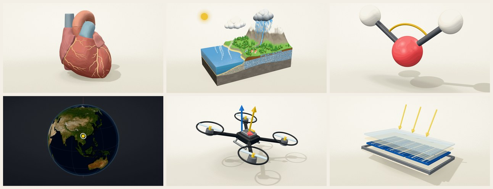</td>
<td><b>A 3D exploration room.</b> 15 guided models across biology, chemistry, geography, computing and engineering: heart and circulation, the water cycle, Earth and seasons, molecular geometry, a quadrotor, solar cells, transistors and more. Three.js loads only when a 3D view is open, and a 2D view is always available.</td>
</tr>
<tr>
<td>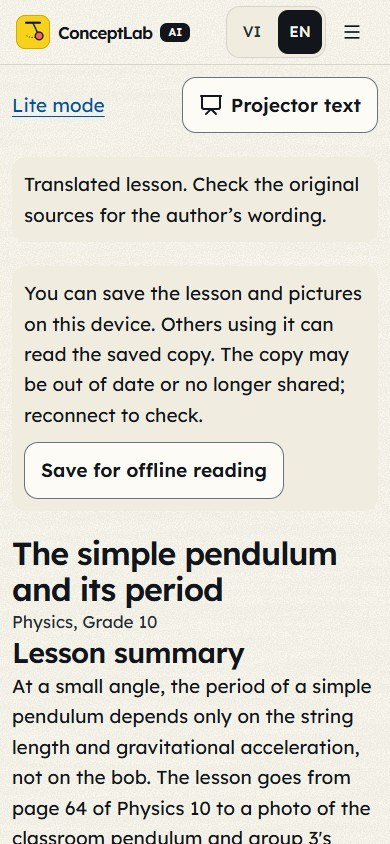</td>
<td><b>Lite mode for low-end phones.</b> Large text in a single column, a projector setting, server-marked quizzes and the tutor. It works on slow networks, and a lesson can be saved for offline reading.</td>
</tr>
</table>

Two spaces share one platform:

| Space | For | Inputs | Interactive output |
|---|---|---|---|
| **School2Lab** | Grades 6–12 students and teachers (incl. physical education) | Textbook pages, lesson plans, board photos, photos of real objects, practice videos, measured values | Step lessons, diagrams, graphs, simulations, sports field, quizzes, clean board sheets |
| **Paper2Explorer** | University students and researchers | Paper PDFs, figures, equations, supplementary data | Paper map, equation explorer, attention and algorithm walkthroughs, sandboxed AI-built widgets |

## How Meta's models power it

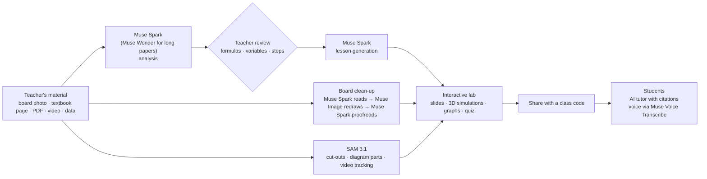

All calls go through one adapter, `backend/app/ai/client.py`, to the Meta Model API.

| Model | Model ID | What it does in ConceptLab | Where |
|---|---|---|---|
| **Muse Spark** | `muse-spark-1.3-contributor` (default) / `muse-spark-1.3` (Standard, private) | Reads images, PDFs and videos; builds lessons, simulations and quizzes; reads and proofreads handwriting; places video markers; translates lessons; answers as the cited tutor; writes sandboxed widget code | `services/analysis.py`, `generation.py`, `board.py`, `quiz_gen.py`, `video_ai.py`, `tutor.py`, `translate.py`, `widgets.py` |
| **Muse Wonder** | `muse-wonder-1.0` | Optional "deep analysis" of long or difficult documents | `services/analysis.py`, `paper.py` |
| **SAM 3.1** | `sam-3.1` | Selects objects by text, click or box; cuts objects out of photos for simulations; makes clickable diagram parts; tracks objects across video frames | `services/segmentation.py`, `video_ai.py` |
| **Muse Image** | `muse-image-1.0` | Redraws a board photo as a clean sheet (`/images/edits`); optional lab cover, always labelled as an AI illustration | `services/board.py`, `generation.py` |
| **Muse Voice Transcribe** | `muse-voice-transcribe-1.0` | Spoken questions to the tutor, biased with the lesson's glossary terms | `services/learning.py` |

Structured outputs (strict JSON schemas) keep every AI result machine-checkable. Numeric answers are recomputed by the app's own formula engine before a question can be approved, and simulation sliders are bound to the model's real inputs.

## Built for trust

- **Grounded.** The tutor only uses the lesson's sources and cites them. Lesson text is treated as material to teach, never as instructions to the model.
- **Private by default.** Labs stay private until published. Media showing students needs explicit consent, and a lab with such media switches its AI calls to Standard mode, where content is not used for training. Videos are never used to identify or rank students.
- **Inclusive.** Vietnamese and English interface and lessons, Lite mode for 2G networks, offline reading, and keyboard and screen-reader support. Interface rules are locked in [`DESIGN.md`](DESIGN.md).

## Project layout

```
backend/            FastAPI app (Python 3.12), SQLite + Alembic, Meta API adapter
  app/ai/           Meta Model API client, prompts, structured output schemas
  app/api/          routers (auth, labs, sources, ai, chat, share, admin, health)
  app/services/     business rules, permissions, media (PDF/image/video/audio), AI services
  app/schemas/      DTOs + the Lab specification contract (spec.py, analysis.py)
  app/seed/         demo labs + original demo materials
  tests/            pytest (offline) + live AI tests (RUN_LIVE_AI=1)
frontend/           React 19 + Vite (JavaScript), bilingual UI, interactive blocks, Three.js scenes
shared/             test vectors shared by Python and JavaScript (expressions, simulations)
docs/               API.md, LAB_SPEC.md, BUILD_PLAN.md, TESTING.md, media for this README
DESIGN.md           the locked visual system (tokens, controls, surfaces, imagery, copy, motion)
e2e/                Playwright browser checks (VI + EN, phone + desktop)
scripts/            dev helpers, demo-material renderers, capture_shots.py, run_muse.ps1
```

## Run it locally

### Requirements

- Python 3.11+ (tested 3.12). `ffmpeg` is bundled through the `imageio-ffmpeg` package.
- Node.js 22.12+ (tested 24) and npm.
- A Meta Model API key for AI features. Without one the app still runs, and the AI buttons explain that AI is not configured.

### Setup (clean machine)

```powershell
# 1. Backend
cd backend
python -m venv .venv
.venv\Scripts\python -m pip install -r requirements-dev.txt
Copy-Item .env.example .env          # then edit .env: set MODEL_API_KEY=... (never commit it)
.venv\Scripts\python -m app.cli init-db
.venv\Scripts\python -m app.cli create-admin --email you@school.edu --name "Your Name"   # prompts for a password
.venv\Scripts\python -m app.cli seed-demo   # published demo labs (--refresh updates them in place)

# 2. Frontend
cd ..\frontend
npm ci
```

(macOS/Linux: `python3 -m venv .venv && .venv/bin/pip install -r requirements-dev.txt`, `cp .env.example .env`.)

All configuration lives in `backend/.env`, and every variable is documented in `backend/.env.example`. The frontend has no secrets and no `.env`.

### Run (development)

```powershell
cd backend;  .venv\Scripts\python -m uvicorn app.main:app --reload --port 8000
cd frontend; npm run dev          # http://localhost:5173  (proxies /api to :8000)
```

Or `powershell -File scripts\dev.ps1` to start both. If those ports are busy, start the backend on another port with `PUBLIC_BASE_URL` set to the frontend address, and start Vite with `API_PROXY_TARGET` pointing at that backend.

Demo labs (no account needed): `/s/TPEND6` pendulum (physics 10) · `/s/VBPASS` volleyball forearm pass (PE 7) · `/s/ATTN24` attention (Paper2Explorer) · `/s/PARAB3` quadratic graphs · `/s/HEART8` circulatory system · `/s/WATER6` water cycle · `/s/SWAP42` bubble sort and binary search · `/s/SAVE25` compound interest · `/s/JUMP45` projectile motion. The 3D room is at `/learn/3d`, and Lite mode is at `/lite`.

### Run (production, single origin)

```powershell
cd frontend; npm run build                     # → frontend/dist (served by FastAPI)
cd ..\backend
# backend/.env: APP_ENV=production, COOKIE_SECURE=true, PUBLIC_BASE_URL=https://your.domain,
#               ALLOWED_ORIGINS=https://your.domain
.venv\Scripts\python -m app.cli init-db
.venv\Scripts\python -m uvicorn app.main:app --host 0.0.0.0 --port 8000 --proxy-headers
```

Put it behind an HTTPS reverse proxy. Back up `backend/data/` (database) and `backend/storage/` (uploaded files) together. Health check: `GET /api/health`. By design for a single-instance deployment, rate limits and video transcoding run in-process. Use PostgreSQL and a job queue before scaling out.

## Tests

```powershell
cd backend;  .venv\Scripts\python -m pytest                       # offline: API, permissions, media, validation, AI with a fake transport
$env:RUN_LIVE_AI="1"; .venv\Scripts\python -m pytest -m live      # real Meta API calls (costs a little)
cd ..\frontend; npm test; npm run check:i18n; npm run build
cd ..; python e2e\smoke.py --base http://localhost:5173            # browser smoke, VI + EN, phone + desktop
```

Current results: backend 565 passed (14 live tests skipped offline). Frontend: 1,001 tests passed in 138 files. Every interface string exists in both languages. See [`docs/TESTING.md`](docs/TESTING.md) for what each suite covers.

## Accounts and roles

Sign-up creates **teacher**, **student** or **researcher** accounts. There is no default admin and no public way to become one: create the first administrator with `python -m app.cli create-admin`. Learners open shared labs with a 6-character class code, with no account needed.

## Design and credits

The interface follows one locked system, [`DESIGN.md`](DESIGN.md), built with the Hallmark design skill and adapted to the Lexend typeface for Vietnamese. 3D scenes follow the img2threejs method: procedural Three.js `Group` factories, checked with screenshots. They live in `frontend/src/lib/three` and `frontend/src/components/lab3d`. The demo materials in `backend/app/seed/assets` (textbook pages, classroom photo, water-cycle diorama, circulation schematic, volleyball clip) are original renders made by `scripts/render/` and `scripts/make_demo_assets.py`. Model attributions are in `docs/bodyparts3d-heart-attribution.md` and `docs/geography-3d-attribution.md`. The optional geography map uses Mapbox GL JS with a learner-supplied public token, under [Mapbox terms](https://www.mapbox.com/legal/tos/).
